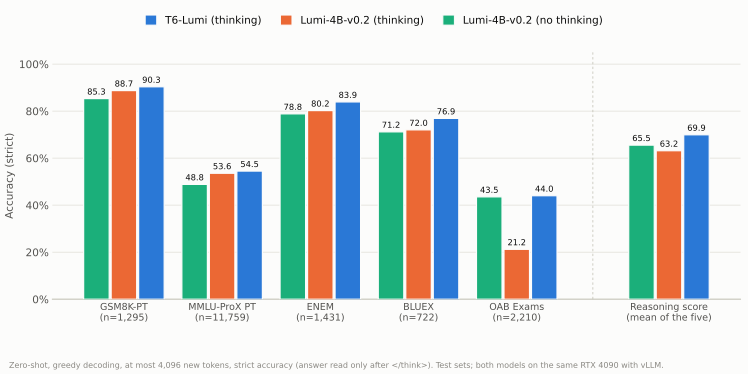
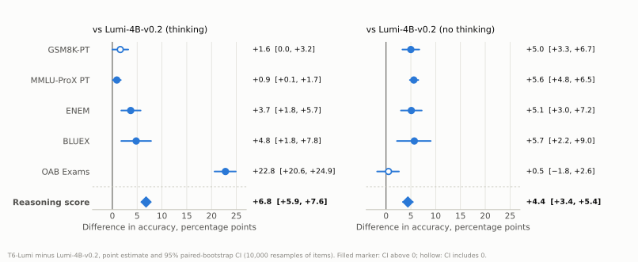
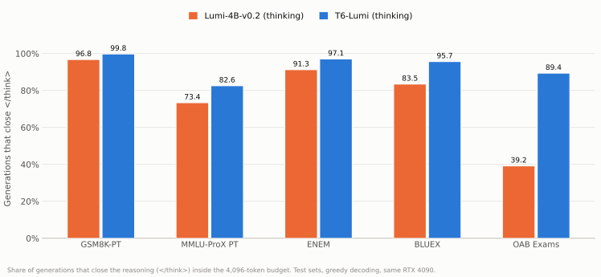
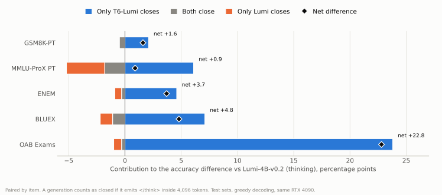
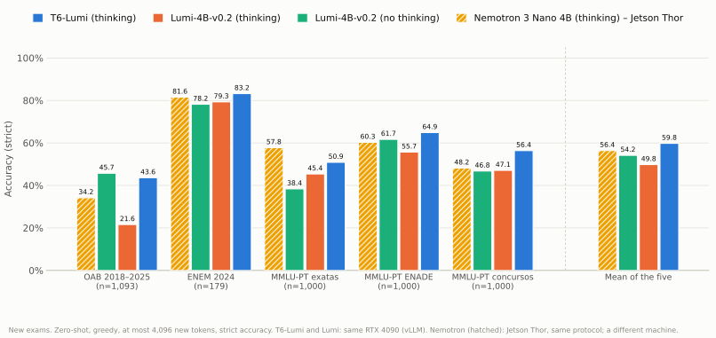
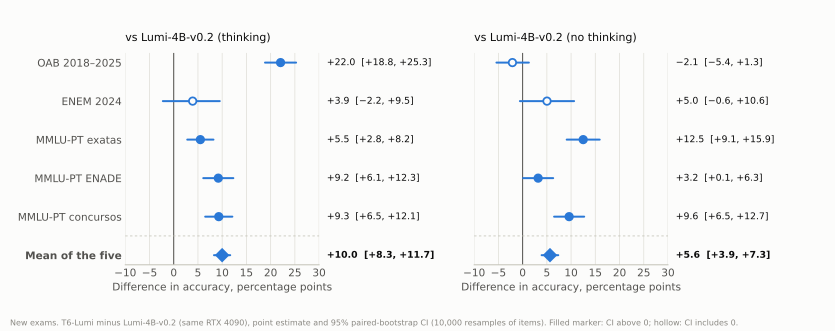
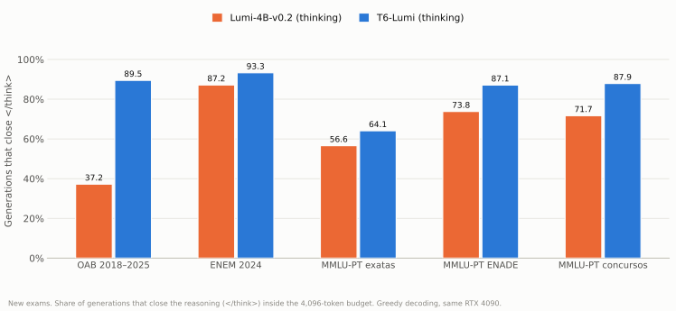
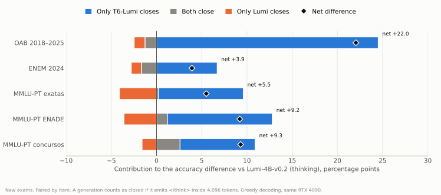
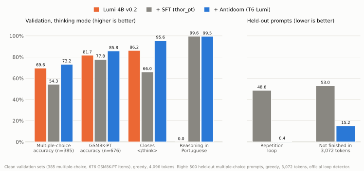

---
language:
- pt
# license: DECISION — see "License" below. Lumi-4B-v0.2 declares none; its parent NVIDIA Nemotron 3 Nano 4B uses the NVIDIA Nemotron Open Model License.

base_model: ceia-br/lumi-4b
base_model_relation: finetune
tags:
  - reasoning
  - thinking
  - portuguese
  - supervised-fine-tuning
  - lora
  - ftpo

datasets:
- Polygl0t/gigaverbo-v2-sft
- Polygl0t/gsm8k-pt
- open-r1/Mixture-of-Thoughts
- TIGER-Lab/WebInstruct-verified
- openlifescienceai/medmcqa
pipeline_tag: text-generation

---

<div align="center">
  <h1>T6-Lumi</h1>
  <p>Lumi-4B that reasons in Portuguese and finishes its reasoning.</p>
</div>

# T6-Lumi

**T6-Lumi** is a fine-tune of [**Lumi-4B-v0.2**](https://huggingface.co/ceia-br/lumi-4b) (CEIA/UFG) for its **thinking mode**. Lumi inherits the reasoning mode of NVIDIA Nemotron 3 Nano 4B, but the Lumi release neither trained nor validated it: with thinking on, Lumi reasons in English and often does not finish. On the OAB Exams, for example, it reaches the 4,096-token limit before closing `</think>` in 60.9% of the questions.

T6-Lumi was trained in two stages with parameter-efficient fine-tuning (LoRA), both merged into the weights: **(1) Supervised Fine-Tuning (SFT)** on Portuguese reasoning traces written by NVIDIA Nemotron 3 Nano 30B-A3B, so that the model reasons in Portuguese; and **(2) an anti-looping preference stage** (Antidoom, based on Final Token Preference Optimization, FTPO), so that the model stops falling into repetition loops. The checkpoint has the same architecture, size, tokenizer and chat template as Lumi-4B.

> [!NOTE]
> **Use T6-Lumi with thinking enabled.** The Lumi-4B card asks to keep thinking disabled; T6-Lumi is the opposite. It was not trained or evaluated as a non-thinking model, so for non-thinking use [Lumi-4B](https://huggingface.co/ceia-br/lumi-4b). This release has no RL, RLVR, tool-use or model-identity training.
>
> **The measured gain comes from finishing the reasoning inside a bounded budget, not from better per-item reasoning.** On the five test sets, where Lumi and T6-Lumi both finish, T6-Lumi is 0.3 to 2.7 percentage points less accurate per item; on the new exams that difference goes both ways. See [How to read these results](#how-to-read-these-results) and [New exams](#new-exams).

## Highlights

* **Reasoning in Portuguese:** 97.3% to 100% of the reasoning traces on the five test sets are in Portuguese (Lumi: English).
* **Finishes its reasoning:** closes `</think>` within 4,096 new tokens in 82.6% to 99.8% of the generations, against 39.2% to 96.8% for Lumi.
* **Reasoning score of 69.9%** against 63.2% (Lumi, thinking) and 65.5% (Lumi, non-thinking): **+6.8 pp** (95% CI +5.9 to +7.6) and **+4.4 pp** (95% CI +3.4 to +5.4).
* **Holds on new exams:** on five exams not used for selection (OAB 2018–2025, ENEM 2024 and three MMLU-PT slices), the mean is 59.8% against 49.8% (Lumi, thinking) and 54.2% (Lumi, non-thinking): **+10.0 pp** (95% CI +8.3 to +11.7) and **+5.6 pp** (95% CI +3.9 to +7.3), again because T6-Lumi finishes its reasoning. See [New exams](#new-exams).
* **Cheap to train:** an 18-minute LoRA SFT plus a 6-minute anti-looping stage (and 1.7 h to mine the loops) on one 24 GB GPU.

# Release History

- **TODO (set on publication):** First release of T6-Lumi, built on Lumi-4B-v0.2 (commit `27b30f40`).

## Model Details

- **Model type**: Same as Lumi-4B: a NemotronH hybrid with 42 layers (21 Mamba-2, 17 MLP and 4 attention), 3.97B parameters, BF16. Please refer to the [NVIDIA model card](https://huggingface.co/nvidia/NVIDIA-Nemotron-3-Nano-4B-BF16) for details on the architecture.
- **Parent model**: [ceia-br/lumi-4b](https://huggingface.co/ceia-br/lumi-4b), v0.2, commit `27b30f40`.
- **Difference from the parent**: 72 of the 263 weight tensors changed (the `in_proj` of the 21 Mamba-2 blocks, `up_proj` and `down_proj` of the 17 MLP blocks, the 16 attention projections and `lm_head`). Everything else is identical.
- **Language(s)**: Portuguese (reasoning and answers). English is inherited from Lumi and was not evaluated for T6-Lumi.
- **Tokenizer and chat template**: Unchanged from Lumi-4B.
- **Developed by**: researchers at CEIA (Centro de Excelência em Inteligência Artificial) and students of the BIA (Bacharelado em Inteligência Artificial) at the Federal University of Goiás (UFG).
- **Contact**: [@gustavobarrosss](https://github.com/gustavobarrosss) and [@Pires-De-Andrade](https://github.com/Pires-De-Andrade) (GitHub). <!-- DECISION: confirm contact and project page. -->

## Model Performance

### Evaluation protocol

- **Task format**: zero-shot, with a Portuguese prompt that asks for the final answer in a fixed format (`#### N` for math, `Resposta: <letter>` for multiple choice).
- **Metric**: **strict accuracy**. The answer is read only after `</think>` and must follow the requested format. A generation that never closes `</think>` scores zero.
- **Decoding**: greedy, at most **4,096 new tokens**, vLLM 0.33.0, stop tokens `</s>` and `<|im_end|>` (ids 2 and 11). Thinking on for T6-Lumi and for the "thinking" Lumi columns, off for the "no thinking" Lumi column.
- **Same machine**: T6-Lumi and Lumi were run on the same NVIDIA RTX 4090 (BF16).
- **Test sets** (never used to choose a candidate): [GSM8K-PT](https://huggingface.co/datasets/Polygl0t/gsm8k-pt) test (1,295 items), [MMLU-ProX](https://huggingface.co/datasets/li-lab/MMLU-ProX) Portuguese test (11,759), [ENEM](https://huggingface.co/datasets/eduagarcia/enem_challenge) (1,431), [BLUEX](https://huggingface.co/datasets/nicholasKluge/BLUEX_without_images) without images (722) and [OAB Exams](https://huggingface.co/datasets/eduagarcia/oab_exams) (2,210).
- **Reasoning score**: the unweighted mean of the accuracies on the five test sets.
- **Differences** are in percentage points (pp), computed on unrounded values, with a **95% paired-bootstrap confidence interval** (10,000 resamples of items, within each exam; for the reasoning score, within each exam and then averaged).

### Reasoning benchmarks



| Benchmark | Items | Lumi (no thinking) | Lumi (thinking) | **T6-Lumi (thinking)** | Δ vs Lumi (thinking) | Δ vs Lumi (no thinking) |
| --- | ---: | ---: | ---: | ---: | :---: | :---: |
| GSM8K-PT | 1,295 | 85.3 | 88.7 | **90.3** | +1.6 [0.0, +3.2] | +5.0 [+3.3, +6.7] |
| MMLU-ProX PT | 11,759 | 48.8 | 53.6 | **54.5** | +0.9 [+0.1, +1.7] | +5.6 [+4.8, +6.5] |
| ENEM | 1,431 | 78.8 | 80.2 | **83.9** | +3.7 [+1.8, +5.7] | +5.1 [+3.0, +7.2] |
| BLUEX | 722 | 71.2 | 72.0 | **76.9** | +4.8 [+1.8, +7.8] | +5.7 [+2.2, +9.0] |
| OAB Exams | 2,210 | 43.5 | 21.2 | **44.0** | +22.8 [+20.6, +24.9] | +0.5 [−1.8, +2.6] |
| **Reasoning score** | – | 65.5 | 63.2 | **69.9** | **+6.8 [+5.9, +7.6]** | **+4.4 [+3.4, +5.4]** |



### How to read these results

The reasoning score is higher, and the 95% interval excludes zero for the score and for four of the five exams against Lumi with thinking (on GSM8K-PT the lower limit is 0.0). What the numbers do **not** say is that T6-Lumi reasons better item by item.

1. **The gain comes from finishing the reasoning.** Lumi with thinking runs out of budget on many questions (39.2% of the OAB questions close, against 89.4% for T6-Lumi), and a truncated generation scores zero. Splitting the items by which model closes `</think>` inside 4,096 tokens, almost all of the difference is in the items that only T6-Lumi closes.

   

   

2. **Per item, T6-Lumi is slightly less accurate.** On the items that both models close, T6-Lumi is 0.3 to 2.7 pp below Lumi:

   | Benchmark | Closes `</think>`: T6-Lumi / Lumi | T6-Lumi reasons in Portuguese | Median new tokens: T6-Lumi / Lumi | Accuracy where both close: T6-Lumi / Lumi |
   | --- | :---: | :---: | :---: | :---: |
   | GSM8K-PT | 99.8% / 96.8% | 99.6% | 358 / 360 | 91.2% / 91.7% |
   | MMLU-ProX PT | 82.6% / 73.4% | 99.0% | 1,237 / 1,002 | 70.9% / 73.6% |
   | ENEM | 97.1% / 91.3% | 99.8% | 651 / 582 | 87.8% / 88.1% |
   | BLUEX | 95.7% / 83.5% | 97.3% | 844 / 820 | 85.0% / 86.3% |
   | OAB Exams | 89.4% / 39.2% | 100% | 1,597 / 4,096 | 54.7% / 55.4% |

   *"Closes" is the share of generations that emit `</think>` inside the budget. "Reasons in Portuguese" is measured by a heuristic that counts Portuguese function words, not by a language detector, and has not been reviewed by people at scale. Lumi's reasoning is in English (on GSM8K-PT, 1,254 of its 1,295 traces; 39 have no trace). The Lumi medians are from the Jetson AGX Thor run of the same protocol, except MMLU-ProX (RTX 4090); on the OAB more than half of the Lumi generations hit the 4,096-token limit.*

3. **The advantage depends on the 4,096-token budget.** A larger budget lets Lumi close more of the questions it truncates here, which would shrink the gap. We have not measured this yet.
4. **On the OAB Exams, thinking only ties the non-thinking model**: 44.0% against 43.5% (+0.5 pp, 95% CI −1.8 to +2.6), at a much higher cost in tokens.
5. **Thinking costs tokens.** The median generation has 358 to 1,597 new tokens for T6-Lumi with thinking, against 149 to 216 for non-thinking Lumi.
6. **Selection and variance.** T6-Lumi was chosen by a rule fixed before the test runs, from the validation results of several candidates, and ran on the test sets once. The intervals above cover the sampling of items, not the variance of training or of the machine (the same Lumi differs by up to 1.5 pp between two machines on the test sets above, and by up to 2.3 pp on the new exams). The validation gain on GSM8K-PT, +4.1 pp over Lumi, shrank to +1.6 pp on the test set.

### New exams

T6-Lumi was chosen by a rule fixed before the test runs, from the validation results of several candidates. To see whether the result is specific to the five test sets above, T6-Lumi and Lumi were also run on five exams that no model of this project saw during selection. The protocol is the one above (zero-shot, greedy decoding, at most 4,096 new tokens, strict accuracy), and T6-Lumi and Lumi ran on the same RTX 4090 with vLLM 0.33.0.

- **OAB 2018–2025** (1,093 items): [`russ7/oab_exams_2011_2025_combined`](https://huggingface.co/datasets/russ7/oab_exams_2011_2025_combined), editions from 2018-01 to 2025-01 (the editions of the OAB Exams suite above are left out).
- **ENEM 2024** (179 items): [`maritaca-ai/enem`](https://huggingface.co/datasets/maritaca-ai/enem), 2024 exam, with each figure replaced by its description and the one annulled question dropped.
- **MMLU-PT exatas, ENADE and concursos** (1,000 items each): three slices of [`Portuguese-MMLU/mmlu-pt-knowledge-annotated`](https://huggingface.co/datasets/Portuguese-MMLU/mmlu-pt-knowledge-annotated): exact sciences (OBI, POSCOMP, IME, AFA), ENADE, and public-service exams (BNDES, BACEN, CNU), drawn at random (seed 0).

The exams are used for evaluation only and are not redistributed here. Items that share 10% or more of their 8-grams (and at least 3) with the training data, the validation sets or the five test sets above were removed before the runs. This criterion is looser than "any shared 8-gram" on purpose: that one would have removed 43% of the new OAB items and 54% of ENADE because of exam boilerplate and statute text, not repeated questions. The items with no shared 8-gram at all are reported separately below.



| Exam | Items | Lumi (no thinking) | Lumi (thinking) | **T6-Lumi (thinking)** | Δ vs Lumi (thinking) | Δ vs Lumi (no thinking) |
| --- | ---: | ---: | ---: | ---: | :---: | :---: |
| OAB 2018–2025 | 1,093 | 45.7 | 21.6 | **43.6** | +22.0 [+18.8, +25.3] | −2.1 [−5.4, +1.3] |
| ENEM 2024 | 179 | 78.2 | 79.3 | **83.2** | +3.9 [−2.2, +9.5] | +5.0 [−0.6, +10.6] |
| MMLU-PT exatas | 1,000 | 38.4 | 45.4 | **50.9** | +5.5 [+2.8, +8.2] | +12.5 [+9.1, +15.9] |
| MMLU-PT ENADE | 1,000 | 61.7 | 55.7 | **64.9** | +9.2 [+6.1, +12.3] | +3.2 [+0.1, +6.3] |
| MMLU-PT concursos | 1,000 | 46.8 | 47.1 | **56.4** | +9.3 [+6.5, +12.1] | +9.6 [+6.5, +12.7] |
| **Mean of the five** | – | 54.2 | 49.8 | **59.8** | +10.0 [+8.3, +11.7] | +5.6 [+3.9, +7.3] |



**How to read the new exams**

1. **The advantage holds on exams that were not used for selection, at the 4,096-token budget.** The mean over the five exams is 59.8% for T6-Lumi, against 49.8% for Lumi with thinking (**+10.0 pp**, 95% CI +8.3 to +11.7) and 54.2% for Lumi without thinking (**+5.6 pp**, 95% CI +3.9 to +7.3). Against Lumi with thinking, four of the five exams have an interval above zero; ENEM 2024 (179 items) does not separate. Against Lumi without thinking, MMLU-PT exatas and concursos clearly favor T6-Lumi, ENADE barely does (lower limit +0.1), and the OAB (−2.1) and ENEM 2024 are ties. As on the suite, T6-Lumi with thinking only ties non-thinking Lumi on the OAB.
2. **The gain is still finishing the reasoning.** On the OAB, T6-Lumi closes `</think>` in 89.5% of the generations against 37.2% for Lumi, and the 54.7% of the items that only T6-Lumi closes contribute +24.5 pp of the +22.0 pp difference. Where both models close, the difference is small and goes both ways: T6-Lumi is below Lumi on the OAB (55.0% against 58.7%) and on ENEM 2024, and at or above it on the three MMLU-PT slices. Items that only Lumi closes cost T6-Lumi between 1.1 and 4.1 pp; on MMLU-PT exatas, 35.9% of the T6-Lumi generations still do not close inside 4,096 tokens.

   

   

| Exam | Closes `</think>`: T6-Lumi / Lumi | T6-Lumi reasons in Portuguese | Median new tokens: T6-Lumi / Lumi | Accuracy where both close: T6-Lumi / Lumi | Items closed only by T6-Lumi / only by Lumi |
| --- | :---: | :---: | :---: | :---: | :---: |
| OAB 2018–2025 | 89.5% / 37.2% | 100.0% | 1,641 / 4,096 | 55.0% / 58.7% | 54.7% / 2.5% |
| ENEM 2024 | 93.3% / 87.2% | 100.0% | 675 / 555 | 90.1% / 92.1% | 8.4% / 2.2% |
| MMLU-PT exatas | 64.1% / 56.6% | 93.1% | 2,428 / 2,710 | 83.3% / 82.9% | 14.3% / 6.8% |
| MMLU-PT ENADE | 87.1% / 73.8% | 99.9% | 1,266 / 1,196 | 77.1% / 75.4% | 18.0% / 4.7% |
| MMLU-PT concursos | 87.9% / 71.7% | 96.2% | 941 / 848 | 70.2% / 66.4% | 19.4% / 3.2% |

3. **Items with no shared 8-gram.** Restricted to the 656, 176, 968, 535 and 934 items of the five exams that share no 8-gram with the training or evaluation data, the mean difference is +9.2 pp (95% CI +7.5 to +11.1) against Lumi with thinking and +6.6 pp (+4.7 to +8.4) against Lumi without thinking.
4. **Expectations written before the runs.** For the OAB we expected +15 to +25 pp against Lumi with thinking and −2 to +3 against Lumi without it; for ENEM 2024, 0 to +8 against both; for MMLU-PT, positive and smaller than on the OAB against Lumi with thinking (no expectation against Lumi without it). Everything fell inside, except the OAB against Lumi without thinking, whose point estimate (−2.1) is 0.1 pp below the range (the interval includes zero, so it reads as a tie).
5. **Machines.** Nemotron 3 Nano 4B was run with the same protocol on a **Jetson Thor**, not on the RTX 4090, so its rows below are not a same-machine comparison. The same Lumi scores differently on the two machines: up to 2.3 pp per exam and mode (OAB with thinking: 21.6% on the RTX 4090, 19.3% on the Jetson Thor), and 0.6 and 0.9 pp on the five-exam mean (with and without thinking). Differences between a model on one machine and another on the other are therefore only indicative, and no confidence interval is given for them.

| Exam | Nemotron (no thinking) | Nemotron (thinking) | T6-Lumi minus Nemotron (thinking) | T6-Lumi minus Nemotron (no thinking) |
| --- | ---: | ---: | :---: | :---: |
| OAB 2018–2025 | 43.1 | 34.2 | +9.4 | +0.5 |
| ENEM 2024 | 66.5 | 81.6 | +1.7 | +16.8 |
| MMLU-PT exatas | 37.8 | 57.8 | −6.9 | +13.1 |
| MMLU-PT ENADE | 51.0 | 60.3 | +4.6 | +13.9 |
| MMLU-PT concursos | 44.5 | 48.2 | +8.2 | +11.9 |
| **Mean of the five** | 48.6 | 56.4 | +3.4 | +11.2 |

   On the five-exam mean, T6-Lumi is 3.4 pp above Nemotron with thinking and 11.2 pp above it without thinking (indicative). Nemotron is above T6-Lumi on MMLU-PT exatas (57.8% against 50.9%), a gap larger than the machine effect seen with Lumi. Nemotron reasons in English (0.1% to 1.3% of its traces are in Portuguese; T6-Lumi: 93.1% to 100%).

### How it was built



On the clean validation sets (385 multiple-choice items from Global-MMLU, MMLU-ProX and INCLUDE, and 676 GSM8K-PT items), the SFT alone moves the reasoning to Portuguese but breaks it: **48.6%** of the held-out multiple-choice prompts fall into a repetition loop and only 66.0% of the generations close `</think>`. The anti-looping stage removes the loops (0.4%) and brings accuracy back to Lumi's level (73.2% against 69.6%, a difference within the noise of a 385-item set; on GSM8K-PT, 85.8% against 81.7%, the interval excludes zero). The stage was repeated with three more training seeds on the same mined events:

| Run | Multiple-choice accuracy | Closes `</think>` | Repetition loops (held-out) |
| --- | ---: | ---: | ---: |
| Lumi-4B-v0.2 | 69.6 | 86.2 | – |
| SFT only | 54.3 | 66.0 | 48.6 |
| SFT + Antidoom, seed 0 (our port of the recipe) | 73.2 | 93.0 | 2.2 |
| **SFT + Antidoom, official trainer (T6-Lumi)** | **73.2** | **95.6** | **0.4** |
| SFT + Antidoom, seed 1 | 72.5 | 91.9 | 3.6 |
| SFT + Antidoom, seed 2 | 74.0 | 95.3 | 0.8 |

*Validation, thinking mode, greedy, 4,096 tokens; loops on 500 held-out multiple-choice prompts, 3,072 tokens, with the official loop detector. The seeds vary only the training seed of the anti-looping stage (same SFT, same mined events); the SFT and the mining ran once. The multiple-choice validation set has 385 items, so differences of 3 to 4 pp are within noise.*

## Usage

> [!NOTE]
> The examples below are templates, validated against the evaluation protocol above (vLLM 0.33.0) but not against the released repository ID. Replace `<repo-id>` with the final repository ID. Greedy decoding is the only setting we evaluated: sampling is not validated.

### vLLM (offline, as evaluated)

```sh
uv venv --python 3.12 --seed
source .venv/bin/activate
uv pip install "vllm==0.33.0"
```

```python
from transformers import AutoTokenizer
from vllm import LLM, SamplingParams

repo_id = "<repo-id>"
tokenizer = AutoTokenizer.from_pretrained(repo_id)
prompt = tokenizer.apply_chat_template(
    [{"role": "user", "content": "Se 3 canetas custam R$ 4,50, quanto custam 10 canetas? Explique o raciocínio."}],
    tokenize=False,
    add_generation_prompt=True,
    enable_thinking=True,  # the default of the chat template; the prompt ends with "<think>\n"
)

llm = LLM(model=repo_id, dtype="bfloat16", max_model_len=8192, generation_config="vllm")
params = SamplingParams(temperature=0.0, max_tokens=4096, stop_token_ids=[2, 11], skip_special_tokens=False)
text = llm.generate([prompt], params)[0].outputs[0].text

reasoning, closed, answer = text.partition("</think>")
print("closed:", bool(closed))  # False: the 4,096-token budget ended before the reasoning did
print(answer.strip())
```

### vLLM (OpenAI-compatible server)

```sh
vllm serve <repo-id> --host 127.0.0.1 --max-model-len 8192
```

```python
from openai import OpenAI

client = OpenAI(base_url="http://localhost:8000/v1", api_key="EMPTY")
result = client.chat.completions.create(
    model="<repo-id>",
    messages=[{"role": "user", "content": "Explique o que é inteligência artificial em português brasileiro, com um exemplo simples."}],
    max_tokens=4096,
    temperature=0,
    extra_body={"stop_token_ids": [2, 11], "chat_template_kwargs": {"enable_thinking": True}},
)

# Without a reasoning parser, the reasoning comes first in `content`, closed by </think>.
reasoning, closed, answer = result.choices[0].message.content.partition("</think>")
print(answer.strip() if closed else "(the reasoning did not finish inside max_tokens)")
```

### Best Practices

- Keep **thinking enabled** (`enable_thinking=True`, the default of the chat template) and give the generation room: all our results use 4,096 new tokens. With a smaller `max_tokens` the reasoning may not close, and a generation that does not close has no answer.
- Read the answer **after `</think>`**. The text before it is the reasoning, in Portuguese.
- For non-thinking use, use [Lumi-4B](https://huggingface.co/ceia-br/lumi-4b) instead.
- Use the chat template distributed with this checkpoint (identical to Lumi's).

### Unvalidated use cases

- **Sampling**: only greedy decoding was evaluated. The Lumi-4B card gives no sampling recommendation yet; the card of its parent model, NVIDIA Nemotron 3 Nano 4B, recommends temperature 1.0 and top-p 0.95 for reasoning (0.6 and 0.95 for tool calling). We have not tested any sampling setting on T6-Lumi.
- **Token budgets other than 4,096**, and long inputs. The base architecture supports a much longer context; we did not validate it.
- **Non-thinking mode**: not a supported mode (use Lumi-4B). In the few measurements we have, T6-Lumi without thinking is close to Lumi or slightly below it (GSM8K-PT 84.5% against 85.3%; validation multiple choice 62.3% against 63.9%).
- **English, other languages, tool use, system prompts and multi-turn chat**: not evaluated.
- **Model identity**: no dedicated identity training, as in Lumi-4B.

## Training Procedure

Both stages start from Lumi-4B-v0.2 and run on one NVIDIA RTX 4090 (24 GiB), BF16. Stage 1 uses a custom PyTorch training loop (so that we control exactly which tokens enter the loss); stage 2 uses the official Antidoom trainer. Each adapter was merged into the weights.

| | Stage 1: SFT | Stage 2: anti-looping (Antidoom / FTPO) |
| --- | --- | --- |
| Goal | Reason in Portuguese | Remove repetition loops |
| Adapter | LoRA r=16, α=32, no dropout, on `in_proj` (Mamba-2), `up_proj`/`down_proj` (MLP) and `q/k/v/o_proj` (attention): 71 modules, 17.1M trainable parameters | New LoRA r=256, α=128 on the same modules and `lm_head`: 307M trainable parameters |
| Data | 10,471 rows, 5.15M tokens (below) | 3,324 preference pairs (3,394 mined events, after filtering) |
| Optimization | lr 1e-4, 1 epoch (328 steps), effective batch 32, loss on response tokens only, at most 2,048 tokens per example | lr 1.5e-5, 1 epoch, effective batch 16, early stop when the fraction of chosen tokens above the rejected token reaches 0.4 (90 steps) |
| Time | 17.6 min | 6 min training, plus 1.7 h to mine the loops |

**Stage 2 in short.** The SFT model generated answers to 10,000 training prompts (8,000 multiple choice, 2,000 math) at temperature 0.1, top-k 50, min-p 0.01, up to 4,000 tokens. A detector found where a repeated span starts. At that point the first token of the repetition is the *rejected* token and the model's own coherent alternatives are the *chosen* tokens. The preference loss acts only on that single token position and keeps the rest of the vocabulary close to the reference. 40.3% of the multiple-choice and 8.65% of the math generations contained a loop. The loop events were mined with our port of the [official Antidoom](https://github.com/Liquid4All/antidoom) recipe (checked against the official functions with unit tests), and the preference training used the official trainer (Apache-2.0), adapted only to the installed library versions.

## Training Datasets

### SFT

Reasoning traces were written in English by [Nemotron 3 Nano 30B-A3B](https://huggingface.co/nvidia/NVIDIA-Nemotron-3-Nano-30B-A3B-BF16) for the problems below, then translated into Portuguese by the same model (temperature 0, with automatic checks on length and numbers; no human audit of the translations). Only traces whose final answer equals the key were kept.

- **4,927 reasoning examples**: 1,719 math problems from the [GSM8K-PT](https://huggingface.co/datasets/Polygl0t/gsm8k-pt) train split, 1,034 math problems from [GigaVerbo-v2 SFT](https://huggingface.co/datasets/Polygl0t/gigaverbo-v2-sft), and 2,174 multiple-choice science questions from the science subset of [Mixture-of-Thoughts](https://huggingface.co/datasets/open-r1/Mixture-of-Thoughts) (answer key: majority letter of the DeepSeek-R1 traces, not an official key).
- **5,544 rows without reasoning** from [GigaVerbo-v2 SFT](https://huggingface.co/datasets/Polygl0t/gigaverbo-v2-sft), to keep the non-reasoning behavior.

### Anti-looping

Only the *prompts* are used (the completions are the model's own, and no answer key is involved): GSM8K-PT train math, Portuguese translations of science multiple-choice questions from Mixture-of-Thoughts, and Portuguese translations of [WebInstruct-verified](https://huggingface.co/datasets/TIGER-Lab/WebInstruct-verified) and [MedMCQA](https://huggingface.co/datasets/openlifescienceai/medmcqa) questions.

### Decontamination

The SFT data and the anti-looping prompts were checked against the validation and test sets with an 8-gram index and, for math, with a signature of the numbers in each problem plus Jaccard similarity over words; overlapping items were removed. This check also found that about a third of the original GSM8K validation set was repeated, translated differently, in the training data, so validation uses only the 676 clean items.

## Ongoing evaluation

Not yet available, and not part of the numbers above: (i) the same comparison with an 8,192-token budget and with sampling (temperature 0.6); (ii) the other three runs of the recipe on the test sets and on the new exams; (iii) human review of the Portuguese reasoning traces. Results will be added to this card, favorable or not.

## Risks and Limitations

T6-Lumi may generate inaccurate, biased or unsupported content, and its reasoning can be wrong or unfaithful even when it reads well. In addition:

- It is not a better reasoner than Lumi per item (see above); its advantage is finishing inside a token budget.
- Reasoning in thinking mode is long: the median is 358 to 1,597 tokens on the evaluated tasks, and between 0.2% and 17.4% of the generations (depending on the exam) still do not close inside 4,096 tokens. On the validation set and in a 3,000-prompt probe, what remains is mostly long, indecisive reasoning and not repetition; we did not measure this split on the test sets.
- The Portuguese reasoning was produced by translating a teacher's English traces with the teacher itself, and the translations were not audited by people. The language share is measured by a heuristic.
- Multiple-choice science answer keys in the SFT data are weak (majority vote of another model).
- Evaluation covers Brazilian exams and grade-school math only, one training run for the released checkpoint, and decoding with a fixed budget.
- All evaluation data and prompts are in Portuguese; performance in other languages and specialized domains requires dedicated evaluation.

## License

<!-- DECISION: license. Lumi-4B-v0.2 declares none; its parent NVIDIA Nemotron 3 Nano 4B uses the NVIDIA Nemotron Open Model License, and the teacher traces come from a model under the same license. -->
**TODO:** confirm the release license with the Lumi maintainers. Lumi-4B-v0.2 does not declare a license, and the NVIDIA Nemotron 3 Nano 4B it derives from is released under the [NVIDIA Nemotron Open Model License](https://huggingface.co/nvidia/NVIDIA-Nemotron-3-Nano-4B-BF16).

## Reproducibility

The training and evaluation code, every run configuration, the answer-extraction rules, the paired-bootstrap scripts and the full experiment log (including the negative results) are in the [project repository](https://github.com/Pires-De-Andrade/lumi4b_lora). The figures of this card are generated by `scripts/make_card_figures.py` from the numbers in that log.

## Acknowledgements

We thank the NLP team at CEIA/UFG for Lumi-4B, NVIDIA for Nemotron 3 Nano 4B (the parent) and Nemotron 3 Nano 30B-A3B (the teacher), Liquid AI for the Antidoom method and code, and Polygl0t, Hugging Face (Open-R1), TIGER-Lab and the MedMCQA authors for the datasets.

<!-- DECISION: add confirmed institutional support and computing-resource acknowledgements. -->

## Authors

T6-Lumi was developed by researchers at CEIA (Centro de Excelência em Inteligência Artificial) and students of the BIA (Bacharelado em Inteligência Artificial) at the Federal University of Goiás (UFG).

[@gustavobarrosss](https://github.com/gustavobarrosss) · [@Pires-De-Andrade](https://github.com/Pires-De-Andrade)

<!-- DECISION: confirm the author list and affiliation. -->

## How to cite

```bibtex
@misc{t6lumi2026,
  title        = {T6-Lumi: a Lumi-4B fine-tune that reasons in Portuguese and finishes its reasoning},
  author       = {TODO: author names},
  year         = {2026},
  howpublished = {Hugging Face model repository},
  url          = {https://huggingface.co/<repo-id>}
}
```

<!-- DECISION: confirm author names for the citation and replace <repo-id>. -->

### References

[1] CEIA/UFG. [Lumi-4B](https://huggingface.co/ceia-br/lumi-4b).

[2] NVIDIA. [Nemotron 3 Nano 4B model card](https://huggingface.co/nvidia/NVIDIA-Nemotron-3-Nano-4B-BF16) and [Nemotron 3 Nano 30B-A3B model card](https://huggingface.co/nvidia/NVIDIA-Nemotron-3-Nano-30B-A3B-BF16).

[3] Liquid AI (2026). [Reducing Doom Loops with Final Token Preference Optimization](https://www.liquid.ai/blog/antidoom); code: [Liquid4All/antidoom](https://github.com/Liquid4All/antidoom).

[4] Paech, S. et al. (2025). *Antislop: A Comprehensive Framework for Identifying and Eliminating Repetitive Patterns in Language Models*. [arXiv:2510.15061](https://arxiv.org/abs/2510.15061).

[5] Hu, E. J. et al. (2021). *LoRA: Low-Rank Adaptation of Large Language Models*. [arXiv:2106.09685](https://arxiv.org/abs/2106.09685).
